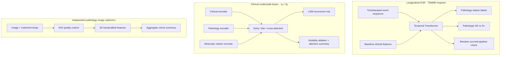

# LNM9 Multimodal Research Suite

**A reproducible research workspace for longitudinal clinical modeling, multimodal fusion, and pathology image radiomics.**

This repository brings together three related but distinct experiments built around the available LNM9 materials:

1. **Longitudinal EHR modeling** — a TAMME-inspired temporal Transformer for timestamped clinical events and pathology targets.
2. **Clinical multimodal fusion** — early fusion, late fusion, cross-attention, and modality ablation for 1-year and 3-year lymph-node recurrence classification.
3. **Pathology image radiomics** — a 150-pair image/trimap feature extraction workflow with summary visualizations.

> **Research prototype only.** These small-cohort experiments are not clinically validated and must not guide care. The image set has no verified patient-ID link to the LNM9 follow-up cohort, so image radiomics is reported as a separate experiment and is not presented as an input to the recurrence fusion models. The source all-cause `survival` field is entirely blank. The Kaplan–Meier plots use dated LNM recurrence as the event and therefore show recurrence-free survival, not overall survival.

## Project map



The EHR and fusion tracks use the LNM9 clinical/event workbooks. The image track processes the separately supplied image/trimap collection. Their results are intentionally kept separate because an image-to-patient crosswalk was not available.

## Results at a glance

### Clinical fusion: LNM recurrence

Five-fold stratified out-of-fold evaluation; metrics are exploratory because the eligible event counts are small.

| Horizon | Eligible patients | LNM events | Early fusion AUC | Late fusion AUC | Cross-attention AUC |
|---|---:|---:|---:|---:|---:|
| 1 year | 98 | 6 | 0.556 | 0.670 | 0.663 |
| 3 years | 27 | 8 | 0.638 | 0.586 | 0.691 |


The one- and three-year cohorts differ because cases without sufficient follow-up are censored and excluded from fixed-horizon classification. The original `survival` column is not used: all 127 values are missing. Recurrence labels are derived from the dated `LNM` field, with `Last` used to establish follow-up; short follow-up without a recorded event is censored rather than treated as a negative. Each figure's ROC panel has been replaced by a Kaplan–Meier recurrence-free curve, stratified by the median of out-of-fold cross-attention risk scores. Curves include early-censored patients, are truncated at the corresponding horizon, and use Greenwood confidence bands. This is an exploratory recurrence endpoint, not an overall-survival estimate.

### Pathology image radiomics

The image workflow selected the first 75 numeric IDs per source filename class (150 matched image/trimap pairs). It extracts custom 2D first-order, shape, gradient, and symmetric GLCM features using Pillow and NumPy, then reports aggregate summaries.


The filename classes are retained as provided and their clinical meaning is unverified. JPEG pixel spacing is unavailable, so shape measures use pixel units. This is a custom feature set, not a full PyRadiomics implementation. No patient-level table or source image is included in the repository.

### TAMME-inspired longitudinal EHR experiment

Event records are converted into event-type, subtype, value, and time-aware tokens; selected baseline clinical variables are represented as static tokens. A Transformer encoder with a CLS representation feeds independent pathology and pipeline-check heads.


The `survival` head uses seeded random labels solely to exercise the training/evaluation code because the supplied field is blank. Its metrics are software-pipeline diagnostics, not survival outcomes. The pathology targets are evaluated only for records with an observed pathology assessment; `NaN` and `/` are treated as not tested, not as negative.

For the separate **Pathologic_N N0 vs N+** target, the held-out test ROC is shown below. It uses probability scores from the 19-case test split; open markers show empirical thresholds, and the smooth line is shape-preserving interpolation for readability.


The test AUC is 0.932 (stratified bootstrap 95% CI 0.761–1.000; 8 N0 and 11 N+ cases). This is an exploratory single-split estimate with substantial uncertainty. A vector PDF is also available at results/pathologic_n_n0_vs_nplus_roc.pdf.

After running the TAMME experiment to create the local held-out prediction file, regenerate the ROC exports with:

    python src/plot_pathologic_n_roc.py --predictions results/pathologic_n_n0_vs_nplus_predictions.csv --output-dir results --seed 17

## Methods and limitations

- **Fusion models:** early fusion concatenates encoded modalities; late fusion combines modality-specific predictions; cross-attention learns interactions across clinical, pathology, and molecular representations. Missing modalities are masked, and single-modality ablations are reported.
- **Validation:** fusion metrics use stratified five-fold out-of-fold evaluation. The TAMME-inspired experiment uses a single patient-level 70/15/15 split. Neither track includes external-cohort validation; the available comparison cohort lacks a compatible dated LNM endpoint.
- **Small event counts:** the 1-year and 3-year analyses contain 6 and 8 recurrences, respectively. AUC and accuracy are highly uncertain and should be read as exploratory workflow results.
- **No image fusion claim:** image/trimap pairs are not linked to LNM9 patient IDs, so image features are not merged into the clinical recurrence models.
- **Survival endpoint:** all source `survival` values are missing. The KM plots use dated LNM recurrence and last follow-up to estimate recurrence-free probability; the seeded random survival task exists only in the TAMME-style code-path demonstration.
- **Not the complete TAMME paper reproduction:** this repository adapts selected longitudinal modeling ideas. It does not reproduce the paper's pretrained image/text encoders, self-supervised pretraining, or all reported experiments.

See [the detailed TAMME experiment note](docs/lnm9_tamme_experiment.md) and [the fusion/Kaplan–Meier endpoint note](docs/lnm9_fusion_kaplan_meier.md) for cohort processing, endpoint rules, and interpretation. The original reference is [the TAMME paper](https://papers.miccai.org/miccai-2025/paper/3193_paper.pdf) and [its source repository](https://github.com/go31glX57/tamme).

## Repository layout

```text
src/
  lnm9_tamme_reproduction.py   # TAMME-inspired event Transformer experiment
  plot_pathologic_n_roc.py     # held-out N0 vs N+ ROC figure and bootstrap interval
  lnm9_torch_experiment.py    # 1y/3y early, late, cross-attention fusion
  lnm9_radiomics_150.py       # paired image/trimap feature extraction
  model/                      # multimodal model components
  training/                   # training utilities
  testing/                    # metrics and evaluation helpers
docs/
  lnm9_tamme_experiment.md    # detailed TAMME adaptation and results
  lnm9_fusion_kaplan_meier.md # recurrence-free endpoint and KM method
results/
  *_fusion_results.png        # horizon-specific fusion figures
  lnm9_radiomics_150_summary.png
  lnm9_tamme_reproduction_results.png
  pathologic_n_n0_vs_nplus_roc.png
  pathologic_n_n0_vs_nplus_roc.pdf
  *_summary.json              # aggregate metrics and run metadata
```

## Setup

The LNM9 experiments use Python, PyTorch, NumPy, Matplotlib, and Pillow. Install a PyTorch build compatible with your system first if needed, then install the project dependencies:

```powershell
py -3.12 -m venv .venv
.\.venv\Scripts\Activate.ps1
python -m pip install -r requirements-lnm9.txt
```

## Reproduce the experiments

Keep source workbooks and image files outside this repository. Set paths to your local data folders.

### 1. TAMME-inspired longitudinal EHR

Expected workbook files under `$env:LNM9_ROOT`:

```text
head_neck_tumor_sample2_dataset.xlsx
events2_template.xlsx
```

```powershell
$env:LNM9_ROOT = "D:\datasets\LNM9\cohort"
python src/lnm9_tamme_reproduction.py --root "$env:LNM9_ROOT" --seed 17 --epochs 60 --output-dir results
```

### 2. One-year / three-year clinical fusion

```powershell
python src/lnm9_torch_experiment.py --root "D:\datasets\LNM9\LNM" --seed 17 --output-dir results --epochs 70
```

The script writes horizon-specific figures and aggregate JSON. Patient-level prediction CSVs are local outputs and are excluded from version control.

### 3. Pathology image radiomics

Provide an image directory and its corresponding `trimaps` directory. Numeric IDs and source filename class are used to match pairs.

```powershell
python src/lnm9_radiomics_150.py --images "D:\datasets\hahaha\images" --trimaps "D:\datasets\hahaha\annotations\trimaps" --output-dir results --per-class 75
```

The script writes an aggregate summary figure and JSON, plus local patient/image-level outputs that should remain outside public version control.

## Data handling

Patient workbooks, image files, masks/trimaps, notebooks, model checkpoints, and patient-level prediction outputs are excluded by `.gitignore`. Only source code, documentation, and aggregate figures/metrics are intended for publication. Before making this repository public, review generated artifacts and commit history for identifiable or sensitive information.

## References

- TAMME, *A Holistic Time-Aware Classification Model for Multimodal Longitudinal Patient Data*, MICCAI 2025: [paper](https://papers.miccai.org/miccai-2025/paper/3193_paper.pdf) · [code](https://github.com/go31glX57/tamme)
- Image segmentation / annotation reference used for the separate image workflow: [U-net-segmentation](https://github.com/roseblingbling/U-net-segmentation)
